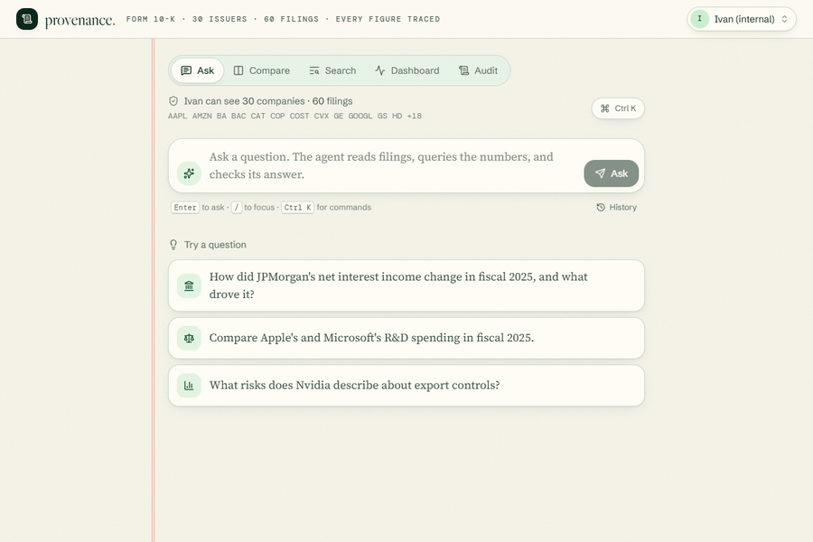
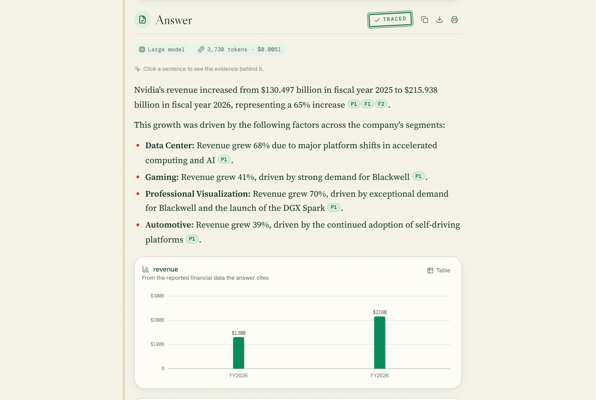
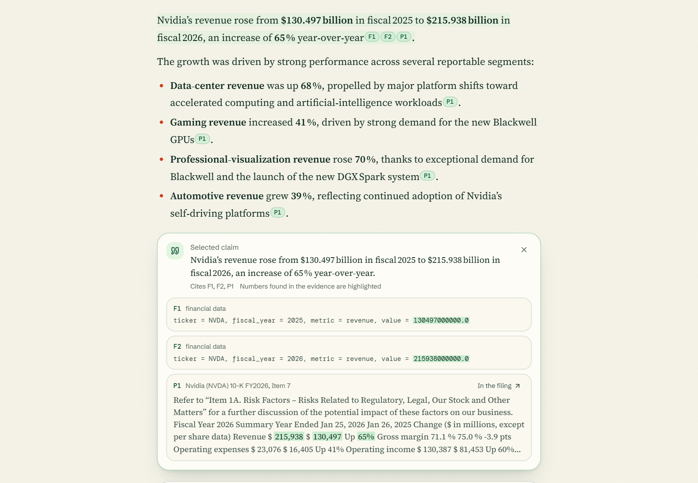
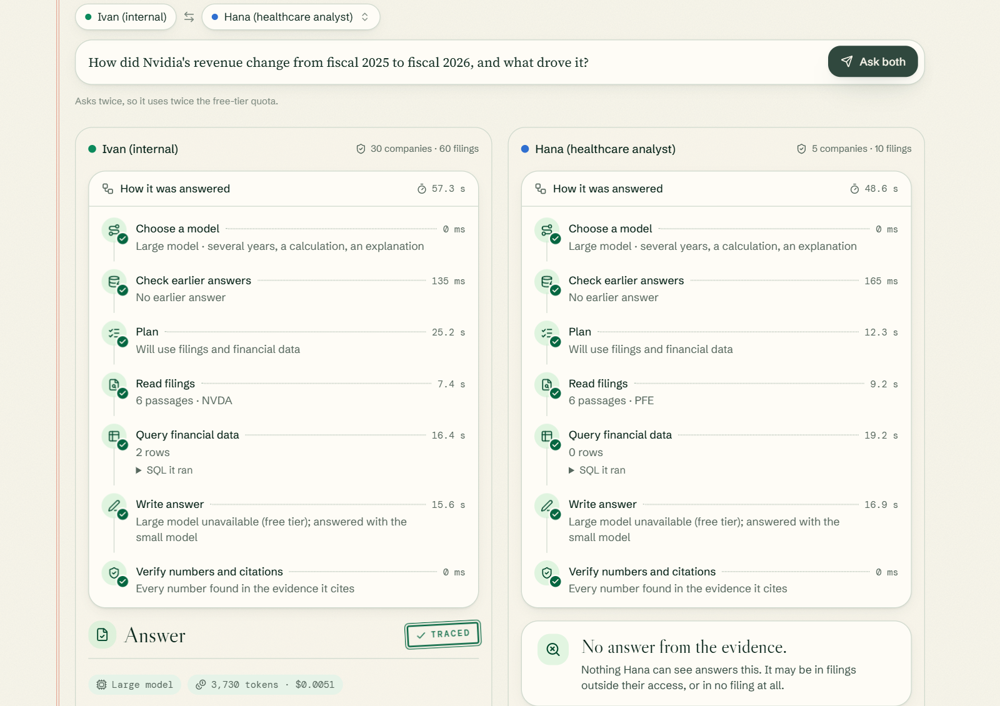
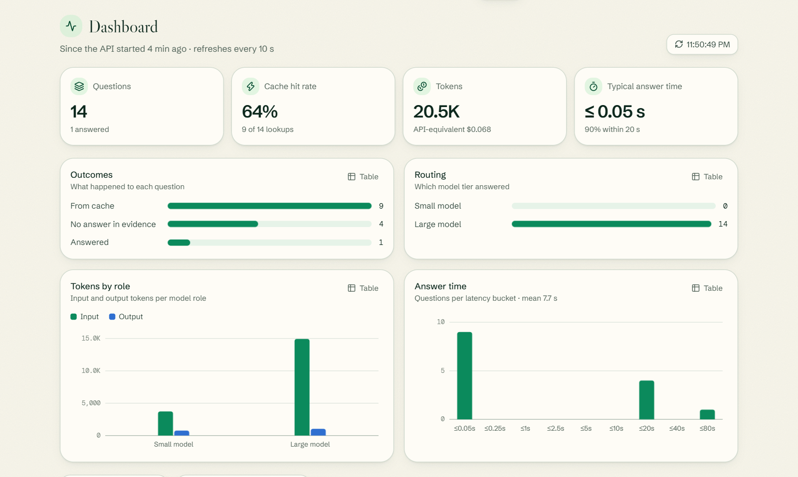
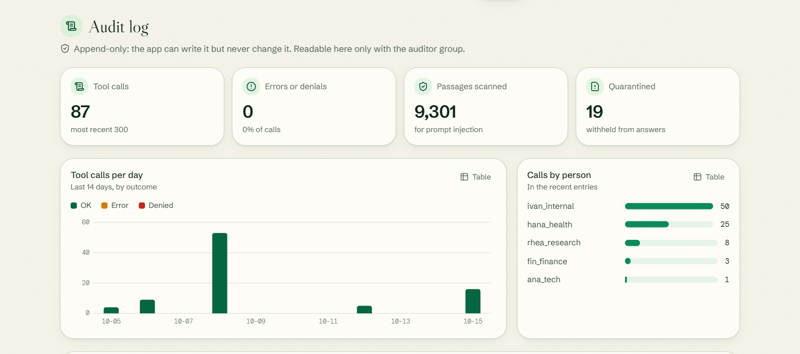
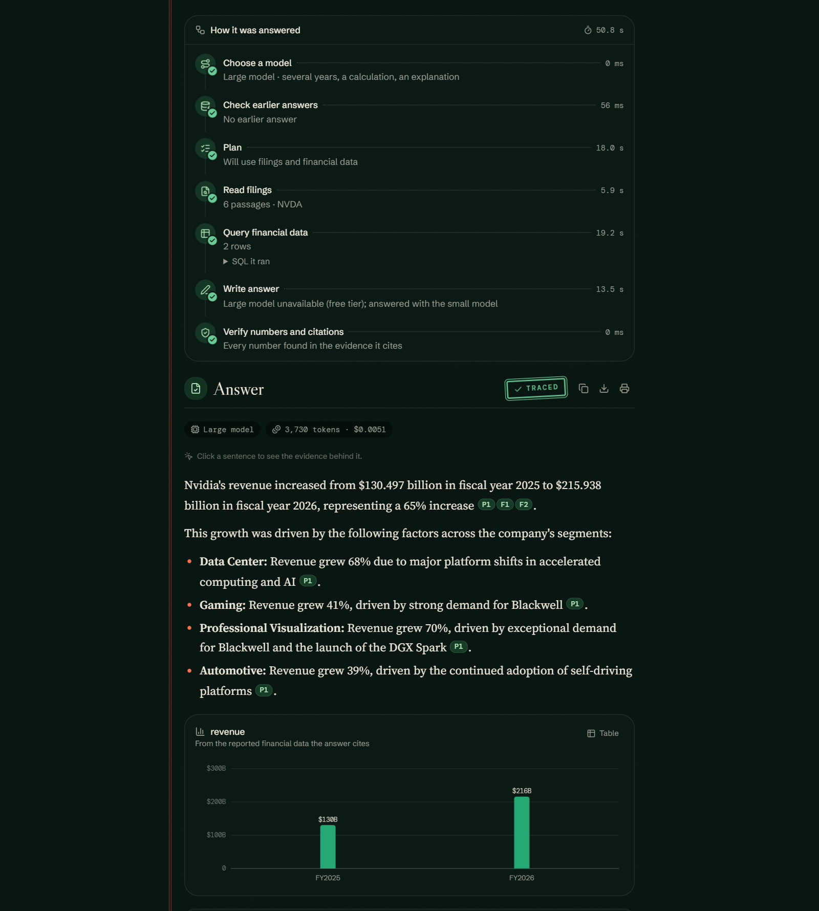

# provenance

A permission-aware question-answering system over SEC 10-K filings.

A user asks a question in plain English. An agent searches the filings, queries the reported
financial data, and writes an answer in which every claim cites its source. Before the answer
is shown, each number in it is checked against the cited evidence. Access control is enforced
by Postgres row-level security, so two users asking the same question can get different
answers depending on which filings they are allowed to read.



The demo is recorded from the running app by [scripts/demo_gif.py](scripts/demo_gif.py), with
waits on the free-tier models shortened. Ivan, who can read every filing, asks how Nvidia's
revenue changed between fiscal 2025 and 2026. The answer streams in, passes verification, and
cites both the filing text and the reported figures. In Compare, Hana, a healthcare analyst,
asks the same question and gets no answer, because the database returns no Nvidia rows to her.

## Key results

| | |
|---|---|
| Retrieval, Recall@1 / Recall@10 | 0.84 / 0.99 (130 questions) |
| Agent vs. retrieve-and-write baseline, correct answers | 79% vs. 64% (107 shared questions) |
| Questions answered from financial data | 39 of 39 vs. 14 of 39 |
| Access-control leaks | 0 in 819 checks |
| Answer-cache false hits | 0.8%, with 76% of paraphrases served |

Every figure is measured, and the full results and their limits are in [Results](#results).

## Screenshots

| | |
|---|---|
|  |  |
| **Verified answer.** Every number is found in the evidence it cites. The chart is drawn from the reported figures. | **Claim inspector.** Clicking a sentence shows the passages and data rows it cites, with its numbers matched at the precision they were written. |
|  |  |
| **Compare.** One question asked as two users. The code path is identical, and the answers differ only because row-level security returns different rows. | **Dashboard.** Live request counts, cache hit rate, model routing, token use, estimated cost and latency, from the controller's metrics. |
|  |  |
| **Audit log.** Visible only to auditors, enforced in the database. Lists every tool call and the passages quarantined as possible prompt injections. | **Dark mode.** |

Screenshots are generated by [scripts/readme_screenshots.py](scripts/readme_screenshots.py).

## Features

**Retrieval.** Hybrid search over about 9,300 passages from 60 filings (30 S&P 500 companies,
two years each). Dense vectors (pgvector) and BM25 (ParadeDB `pg_search`) both run inside
Postgres. Results are merged with reciprocal rank fusion and reranked by a cross-encoder.

**Agent.** A LangGraph graph with explicit nodes. It plans which sources a question needs,
then runs the filing search and a text-to-SQL worker over XBRL financial data in parallel.
If a numbers-only plan finds nothing in the data, it falls back to searching the filings. The
writer produces a cited answer, a deterministic verifier checks every number against the cited
evidence, and a failed answer gets one revision. Each question is capped at five steps.

**Controller.** Wraps the agent with:
- model routing: simple questions go to a small model, and failed answers are retried on a
  large model over the same evidence;
- an answer cache on Redis vector sets, scoped by permissions and guarded by an entity check
  (companies, years, metrics);
- per-user daily token budgets (HTTP 429) and backpressure (HTTP 503);
- Prometheus metrics and OpenTelemetry tracing.

Abstention on low confidence is implemented but disabled, because no calibrated confidence is
served (see [Calibration](#calibration)).

**Security.**
- Row-level security keyed on HMAC-signed group claims, so the database filters rows and the
  application cannot bypass it.
- Generated SQL runs as a read-only role, behind an AST allowlist.
- Every passage is scanned for prompt injection at ingest (pattern rules plus a local
  classifier), and flagged passages are quarantined from the writer.
- An append-only audit log, readable only by members of the auditor group.

**MCP.** `provenance-mcp` gives Claude Desktop and other MCP clients four tools: filing
search, passage lookup, question answering and identity, all scoped to the caller's API key. [mcpgate](packages/mcpgate) is a standalone gateway that sits in front of
any MCP server and detects tool poisoning, changed tool definitions ("rug pulls") and injected
tool output.

**Web app** (React 19, Vite, Tailwind):
- streams the agent's steps and the answer text over SSE;
- citations open the source passage with the cited span highlighted;
- clickable sentences show the evidence behind each claim;
- answers with numbers get charts, and each answer has a per-step timing chart;
- views for Compare, the metrics Dashboard and the auditor-only Audit log;
- per-user history, Markdown and PDF export, and a Ctrl+K command palette.

**Cost.** Everything runs on free tiers (Gemini and Groq) and CPU-only local encoder models.
Cost figures are *API-equivalent*: measured token counts priced at Claude Haiku and Sonnet
list prices. They are not a bill.

## Architecture


Design decisions and the alternatives considered are in [docs/decisions.md](docs/decisions.md).

## Results

All results come from reproducible eval runs. The reports are in [eval/reports/](eval/reports),
and no eval was tuned toward a target number.

### Retrieval

130 golden questions with labelled gold passages. Brackets show 95% bootstrap intervals.

| configuration | Recall@1 | Recall@5 | Recall@10 | MRR@10 |
|---|---|---|---|---|
| dense only | 0.53 [0.45-0.61] | 0.79 [0.72-0.86] | 0.92 [0.87-0.96] | 0.64 [0.57-0.71] |
| hybrid (dense + BM25) | 0.61 [0.52-0.69] | 0.83 [0.77-0.89] | 0.89 [0.84-0.94] | 0.71 [0.64-0.77] |
| hybrid + rerank | 0.80 [0.72-0.87] | 0.94 [0.89-0.98] | 0.95 [0.92-0.98] | 0.86 [0.80-0.91] |
| hybrid + rerank + LLM query rewrite | 0.84 [0.77-0.90] | 0.99 [0.96-1.00] | 0.99 [0.98-1.00] | 0.90 [0.85-0.94] |

Reranking gives the largest gain (Recall@1 from 0.61 to 0.80). Query rewriting adds a smaller
improvement at the cost of one extra model call. The first three rows come from
[retrieval-20261005-0745](eval/reports/retrieval-20261005-0745.md), and the last from
[retrieval-20261005-1220](eval/reports/retrieval-20261005-1220.md), after fixes to the query rewrite. The reranker's top score also separates answerable from
unanswerable questions: for unanswerable ones the median top score is about 0.12.

A CI gate reruns this evaluation on every pull request that touches retrieval, and fails if
any metric drops below its recorded floor (see [docs/ci.md](docs/ci.md)).

### Access control

There were **0 leaks in 819 checks** ([report](eval/reports/acl-20261005-1832.md)). Each of 9
users searched for each of the 30 companies with 3 questions and ran an unrestricted SQL
query, and no row from outside their permitted sectors appeared. The retrieval eval also
includes 8 adversarial questions that try to pull other sectors' data. None leaked, in any
configuration.

### Prompt injection

On a test set, pattern rules plus a local classifier caught 5 of 5 standard injection attacks,
with 1 false positive in 300 real filing passages. A subtler social-engineering phrasing evaded
both layers. Detection alone is therefore not relied on: flagged passages are quarantined, and
the agent has no write access to anything.

Across the full corpus, 19 of 9,301 passages (0.2%) were flagged, and on manual review none of
them is an attack. 14 are dense tables, such as patent-expiry schedules and financial
statements, which the classifier scores 0.91-0.99. The other 5 matched a "privilege" pattern in
ordinary sentences. They remain quarantined, because the thresholds were not loosened to
recover them.

### Answer cache

Measured on 172 labelled question pairs ([report](eval/reports/cache-20261005-1914.md)).
Embedding similarity alone is unsafe here. The same question about a different year scores
higher similarity (median 0.97) than a genuine paraphrase (0.94). With the entity check
(companies, years, numbers and metrics must match), false hits are 0.8% (1 of 122 near-misses)
at every threshold tested, and 76% of paraphrases are still served at the configured
similarity threshold of 0.90.

### Answer quality

An LLM judge grades each answer against the golden reference answer, and checks each claim
against the evidence the system retrieved ([eval/answer_eval.py](eval/answer_eval.py)). Because
of free-tier quotas, the baseline answered all 200 questions and the agent answered 107. The
comparison uses the 107 questions both answered. The baseline is a plain pipeline that searches
the filings and writes an answer.

| same 107 questions | baseline | agent |
|---|---|---|
| correct, overall | 64% (68) | **79% (84)** |
| financial-data questions | 14 of 39 | **39 of 39** |
| multi-company questions | 6 of 14 | 9 of 14 |
| text questions | **33 of 38** | 22 of 38 |
| unanswerable questions correctly declined | 11 of 11 | 11 of 11 |
| faithfulness (claims supported by evidence) | 0.99 | 0.99 |
| access leaks | 0 | 0 |

The agent's advantage on financial questions comes from querying the reported figures
directly, which the baseline cannot do.

The text-question deficit was caused by a bug. Some prose facts, such as Apple's headcount,
were planned as numbers-only. The SQL worker found no matching fact, so nothing was searched
and the agent declined. A fallback now searches the filings whenever the SQL step returns
nothing usable ([graph.py](src/provenance/agents/graph.py)). After the fix, a re-run on the text
questions ([report](eval/reports/answers-textonly-agent-20261012-1709.md)) gave:
- on the same 38 questions: 28 correct, up from 22; declines down from 8 to 1; faithfulness
  0.997;
- on all 79 text questions the re-run answered: 68 correct, against the baseline's 72.

The baseline still leads on text. The remaining gap comes from three causes:
- one SQL result that contained a row with a null value, now also treated as empty (that
  question, Apple's headcount, is answered correctly in the answer gate's run);
- one planning error, where the agent summed yearly R&D figures ($72.1B) instead of using the
  cumulative total stated in the filing ($76.7B);
- several list answers that the judge marked as incomplete.

Full reports: [baseline](eval/reports/answers-baseline-20261007-1614.md),
[agent](eval/reports/answers-agent-20261008-1230.md),
[controller](eval/reports/answers-controller-20261009-0523.md).

A second CI gate re-asks 25 fixed questions and fails if correctness, faithfulness or correct
refusals fall below recorded floors ([eval/answer_gate.py](eval/answer_gate.py)). Its first
local run, after the fixes above, passed: 0.83 correct (recorded baseline 0.72, floor 0.57),
faithfulness 1.0, all unanswerable questions declined, 0 leaks.

### Calibration

A per-claim confidence model was built (NLI scores plus number checks, calibrated out-of-fold),
but it is **not served**. Of 587 judged claims, 99% were supported. With that base rate, a model
that predicts "supported" almost every time scores very well on calibration error (ECE 0.003),
yet it barely ranks good claims above bad ones (AUROC 0.58, where 0.5 is chance)
([report](eval/reports/calibration-20261012-1354.md)).

At the answer level, ranking by this confidence raises accuracy from 88% to 91% at 80%
coverage. However, it predicts 99% accuracy for answers that are 88% correct
([report](eval/reports/selective-agent-20261012-1413.md)), because an answer can be fully
supported by its evidence and still be incomplete. Displaying that confidence would overstate
reliability, and scoring costs several seconds of CPU per answer. The system will run without
it until the labels include enough unsupported claims to learn from.

### Cost

Routing produced no measurable saving on free tiers. On 104 shared questions, the controller
cost 0.96 of an always-large-model agent (0.94 including cache hits), at the same accuracy (79%
vs. 78%) ([report](eval/reports/cost-ab-20261012-1339.md)). The comparison is confounded. The
free-tier large model was unavailable for 78% of the agent's answers, which then fell back to the
small model, so both arms mostly ran the same model. Separately, the cache answered 11 of 20
reworded questions, 75% of them correctly.

## Quickstart

Requirements: Docker, [uv](https://docs.astral.sh/uv/), Node 22, and free API keys for Gemini
([AI Studio](https://aistudio.google.com)) and Groq ([console](https://console.groq.com)).

```bash
git clone https://github.com/kedar4real/provenance && cd provenance
cp .env.example .env     # add the API keys, SEC_USER_AGENT ("app-name you@email") and RLS_SIGNING_KEY
python -c "import secrets; print(secrets.token_hex(32))"   # generates an RLS_SIGNING_KEY

docker compose up -d                            # Postgres (ParadeDB) and Redis 8
uv sync
uv run python -m provenance.db.migrate          # schema, roles, row-level security
uv run python -m provenance.ingest              # downloads and embeds 30 companies from EDGAR (slow on CPU)
uv run python -m provenance.api.keys issue ana_tech   # prints an API key once; users are in config/principals.yaml
uv run python -m provenance.api                 # API on http://127.0.0.1:8000

cd web && npm install && npm run dev            # app on http://localhost:5173; add the key in the user menu
```

Ingestion also runs the prompt-injection scan.
- **Tests:** `uv run pytest -m "not integration"`, plus `uv run pytest -m integration` with
  Docker running.
- **Claude Desktop through mcpgate:** see [docs/claude-desktop.md](docs/claude-desktop.md).
- **CI and both regression gates:** see [docs/ci.md](docs/ci.md).

## Project layout

```
src/provenance/
  api/          FastAPI app: auth, routes, SSE, middleware
  agents/       LangGraph agent and answer verification
  controller/   routing, answer cache, budgets, backpressure, metrics
  retrieval/    dense, BM25, fusion, rerank, query rewrite
  sql/          text-to-SQL worker and AST guard
  verifier/     claim scoring and calibration
  security/     injection detection, quarantine, audit log
  ingest/       EDGAR download, section parsing, chunking, embedding
  llm/          provider router, circuit breakers, record/replay cache, metering
  mcp_server/   provenance-mcp
packages/mcpgate/   standalone MCP security gateway
web/                React app
eval/               golden set, evals, reports, CI gates
db/migrations/      schema, row-level security, audit log
```

## Limitations

- **Small corpus.** 30 large US companies, two annual filings each (Items 1, 1A and 7), plus
  XBRL facts. It has full-year figures only, with no quarterly results. The corpus is sized to
  demonstrate the system, not for real research use.
- **Machine-generated golden set.** Questions and reference answers were generated and filtered
  by LLMs, and claim labels come from an LLM judge. A human spot-check of 40 questions and an
  audit of 100 claims are prepared but not yet done. Answer-quality numbers should be read with
  that noise in mind.
- **Free-tier models.** Quotas limit how many questions an eval run completes, and when the large
  model is unavailable the system falls back to a smaller one. The trace records each fallback.
- **Injection detection is not a guarantee.** A crafted passage can evade it. The defences that
  do not depend on detection are least privilege (read-only SQL, no write tools), row-level
  security, and mcpgate's allowlists and tool pinning.
- **The cache's entity check compares sets.** Swapping one of two years already in a question
  goes unnoticed, and changes of subject within the same company and year are not measured.
  For this reason the similarity threshold is not lowered further.
- **No token logprobs.** None of the free providers tested return logprobs, so confidence
  signals come only from NLI and number checks.
- **Batch ingestion.** Ingestion runs as a command-line job, with no automatic re-ingestion when
  new filings are published.
- **mcpgate scope.** It serves clients over stdio (upstreams can be stdio or HTTP) and logs to
  JSONL, with no database audit sink.
