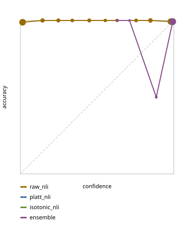

# Claim calibration (2026-10-12 13:54 UTC)

587 judged claims; 99% supported. All scores out-of-fold (5 folds); 95% bootstrap CI for ECE.

| method | ECE | ECE 95% CI | Brier | AUROC |
|---|---|---|---|---|
| raw_nli | 0.662 | 0.629-0.696 | 0.620 | 0.650 |
| platt_nli | 0.000 | 0.000-0.008 | 0.008 | 0.366 |
| isotonic_nli | 0.000 | 0.000-0.008 | 0.009 | 0.479 |
| ensemble (chosen) | 0.003 | 0.001-0.011 | 0.008 | 0.583 |

Ablation: the ensemble without one signal.

| without | ECE | Brier | AUROC |
|---|---|---|---|
| nli_entail | 0.003 | 0.008 | 0.654 |
| nli_contra | 0.002 | 0.008 | 0.631 |
| numbers_ok | 0.003 | 0.008 | 0.582 |
| has_numbers | 0.002 | 0.007 | 0.667 |
| overlap | 0.000 | 0.009 | 0.435 |
| top_rerank | 0.003 | 0.009 | 0.612 |

Answer confidence (weakest claim) vs answer correctness: AUROC 0.585 over 218 answers.

Logprob signal: not available (no free provider tested returns token logprobs).

