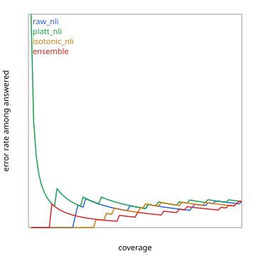

# Selective answering: agent (2026-10-12 14:13 UTC)

82 answered cases (11 declined, excluded). Correct = the judge graded the answer fully correct against the reference.
Confidence = the weakest claim's probability, calibrator fit out-of-fold by question.

| confidence | AURC (lower better) | oracle AURC | acc @80% cov | acc @90% cov | acc @100% |
|---|---|---|---|---|---|
| raw_nli | 0.081 | 0.008 | 0.89 | 0.88 | 0.88 |
| platt_nli | 0.141 | 0.008 | 0.88 | 0.88 | 0.88 |
| isotonic_nli | 0.067 | 0.008 | 0.89 | 0.89 | 0.88 |
| ensemble | 0.064 | 0.008 | 0.91 | 0.91 | 0.88 |

At the configured abstention threshold (config/routing.yaml):

| confidence | threshold | coverage | accuracy of kept | predicted accuracy of kept |
|---|---|---|---|---|
| raw_nli | 0.3 | 0.24 | 0.90 | 0.89 |
| platt_nli | 0.3 | 1.00 | 0.88 | 0.99 |
| isotonic_nli | 0.3 | 1.00 | 0.88 | 0.99 |
| ensemble | 0.3 | 1.00 | 0.88 | 0.99 |

